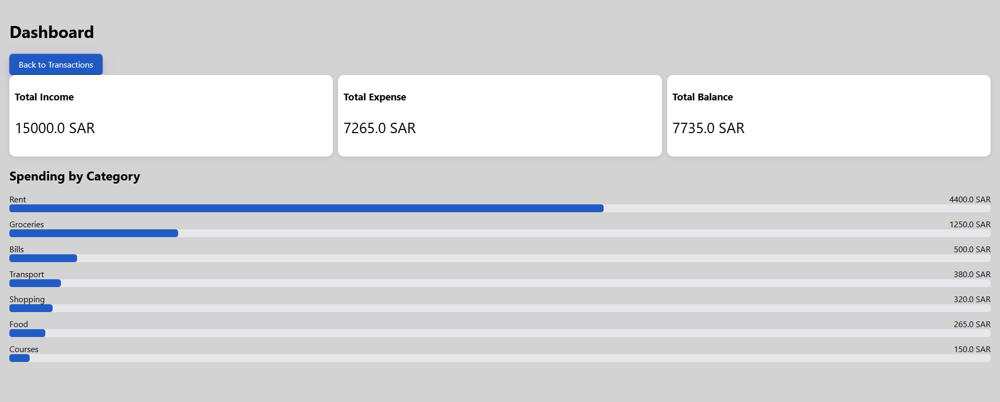
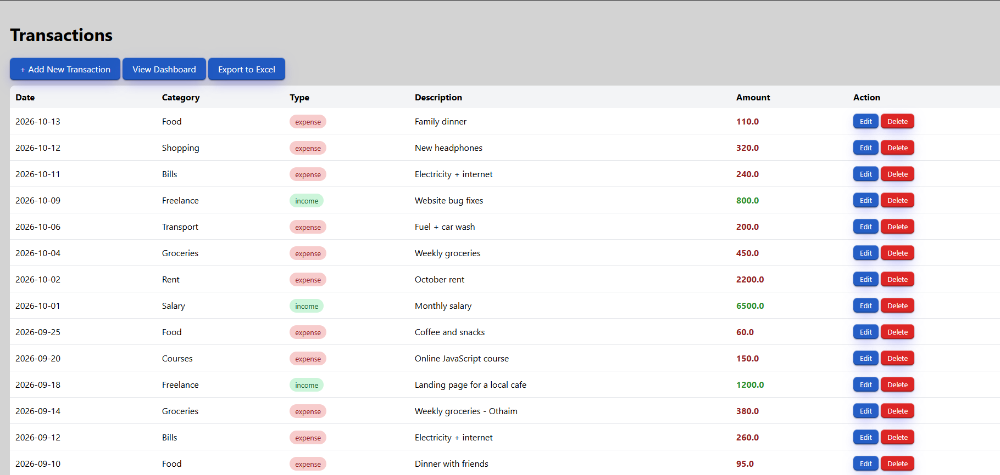
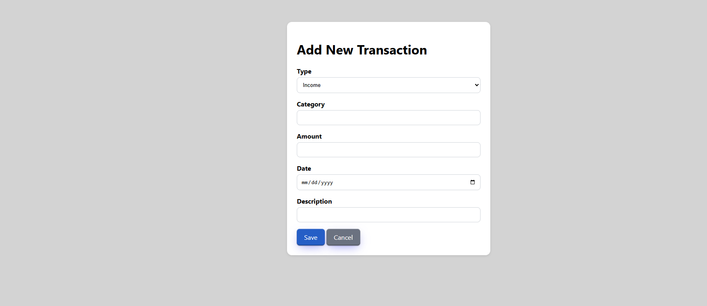

# 💰 Budget Tracker

A full-stack web app to track personal income and expenses, built with **Python, Flask and SQLite**.
Add your transactions, see where your money goes on the dashboard, and export everything to Excel.



## Features

- **Add, edit and delete** income and expense transactions
- **Dashboard** with total income, total expense and balance cards
- **Spending by category** shown as bars, sized by each category's share of total expenses
- **Colored badges** for income / expense, and green / red amounts in the transactions table
- **Export to Excel** (.xlsx) report with one click
- Clean, consistent design using **one shared stylesheet** for all pages

## Screenshots

### Transactions


### Add / Edit form


## Tech Stack

| Part | Tools |
|---|---|
| Backend | Python, Flask |
| Database | SQLite (SQL queries with `SUM`, `GROUP BY`) |
| Frontend | HTML, CSS (Grid, Flexbox), Jinja2 templates |
| Reporting | openpyxl (Excel export) |

## How It Works

- `app.py` defines the **routes** (`/`, `/add`, `/edit/<id>`, `/delete/<id>`, `/dashboard`, `/export`).
- `db.py` handles the **SQLite database**: creating the `transactions` table and all create / read / update / delete queries.
- The dashboard totals are calculated in SQL (`SUM(amount)` per type, `GROUP BY category`), and the bar widths are calculated in the Jinja template.
- `excel_export.py` builds the Excel file in memory and sends it as a download.

## How to Run

1. Clone the repository:
   ```bash
   git clone https://github.com/ahmed71huz/budget-tracker.git
   cd budget-tracker
   ```
2. Create a virtual environment and activate it (Windows PowerShell):
   ```bash
   python -m venv .venv
   .\.venv\Scripts\Activate.ps1
   ```
3. Install dependencies:
   ```bash
   pip install flask openpyxl
   ```
4. Run the app:
   ```bash
   python app.py
   ```
5. Open `http://127.0.0.1:5000` in your browser.

## Next Steps

- Validate form input (amount must be a positive number, date is required)
- Make the layout responsive for mobile screens
- Filter transactions by month
